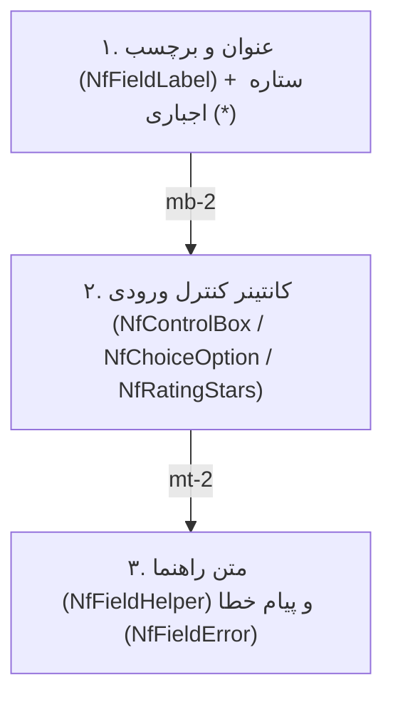

# قرارداد اجباری استایل و رفتار المان‌های فرم (NoroForm Field Style Contract)

این سند قانون طراحی، پیاده‌سازی و یکپارچگی تمامی المان‌های فرم (فیلدها و بلوک‌های محتوایی) در نرم‌افزار نوروفرم است. تمامی فیلدهای فعلی (۱۲ المان) و هرگونه فیلدی که در آینده اضافه شود، باید ۱۰۰٪ منطبق بر این قرارداد باشند.

---

## ۱. آناتومی سه‌بخشی استاندارد فیلدها (Three-Part Field Anatomy)

هر المان فرم از نوع فیلد ورودی به ترتیب شامل ۳ بخش عمودی مستقل و استاندارد است:

1. **عنوان (Label):**
   - کامپوننت پایه: `NfFieldLabel`
   - تایپوگرافی: `text-sm font-medium text-nf-card-foreground leading-relaxed [overflow-wrap:anywhere]`
   - نشانگر اجباری: ستاره سرخ‌رنگ (`*` با کلاس `text-nf-destructive font-bold`) که بلافاصله و بدون شکست سطر به انتهای متن عنوان چسبیده است.
   - فاصله‌گذاری زیر عنوان: دقیقاً `mb-2` (۸ پیکسل) تا کانتینر ورودی.

2. **کنترل ورودی (Control Container):**
   - کامپوننت پایه ورودی‌های متنی/باکسی: `NfControlBox`
   - ارتفاع کنترل تک‌خطی: `h-10 min-h-10` (۴۰ پیکسل)
   - حداقل ارتفاع کنترل چندخطی: `min-h-24` (۹۶ پیکسل)
   - استایل پوسته: `rounded-nf-control border border-nf-border bg-nf-muted/35 text-sm`
   - اسلات آیکون: آیکون‌های استاندارد Lucide با اندازه `size-4 text-nf-muted-foreground` و فاصله `gap-2.5`.
   - گزینه‌ها: ردیف `NfChoiceOption` با نشانگر `size-4 border-2 border-nf-muted-foreground/45` (دایره‌ای برای تک‌انتخابی و مربعی `rounded-[4px]` با آیکون Check برای چندانتخابی).
   - امتیاز: ردیف `NfRatingStars` با ستاره‌های اندازه `size-6 gap-2`.
   - رسانه خالی: قاب خط‌چین `NfMediaPlaceholder` با ارتفاع `min-h-32 rounded-nf-card border border-dashed border-nf-border bg-nf-muted/25`.

3. **راهنما و اعتبارسنجی (Helper & Error):**
   - متن راهنما: `NfFieldHelper` با کلاس `mt-2 text-xs text-nf-muted-foreground leading-normal`.
   - خطای اعتبارسنجی: `NfFieldError` با کلاس `mt-1 text-xs font-medium text-nf-destructive leading-normal`.

---

## ۲. مقیاس فاصله‌گذاری و ابعاد (مضرب ۴ پیکسل)

تمام فاصله‌ها، ارتفاع‌ها و پدینگ‌ها باید الزاماً از مقیاس استاندارد مضرب ۴ پیکسل پیروی کنند:
- پدینگ و گپ‌ها: `p-2` (8px)، `p-3` (12px)، `gap-1.5` (6px)، `gap-2` (8px)، `gap-2.5` (10px)، `gap-3` (12px)
- مارجین‌های عمودی: `mb-2` (8px)، `mt-2` (8px)، `mt-1` (4px)
- ارتفاع کنترل‌ها: تک‌خطی `h-10` (40px)، چندخطی `min-h-24` (96px)، کادر رسانه `min-h-32` (128px)

---

## ۳. توکن‌های مجاز `--nf-*` و ممنوعیت رنگ ثابت

- **قانون صفر رنگ هاردکدشده:** هیچ رنگ ثابتی از قبیل `bg-white`, `bg-gray-*`, `text-slate-*`, `border-zinc-*` یا کدهای Hex در لایه UI فیلدها مجاز نیست.
- **توکن‌های معنایی مجاز برای بوم و رندرر:**
  - پس‌زمینه کارت: `bg-nf-card`
  - رنگ متن روی کارت: `text-nf-card-foreground`
  - کادر و حاشیه: `border-nf-border`
  - سطوح ملایم و پس‌زمینه ورودی: `bg-nf-muted/35`، `bg-nf-muted/25`
  - متن ثانویه و راهنما: `text-nf-muted-foreground`
  - رنگ اصلی و تأکید: `bg-nf-primary`, `text-nf-primary`, `border-nf-primary`
  - متن روی رنگ اصلی: `text-nf-primary-fg`
  - رنگ خطا و منفی: `text-nf-destructive`, `border-nf-destructive`
  - گوشه‌ها: `rounded-nf-card` (برای کارت‌ها و قاب رسانه)، `rounded-nf-control` (برای باکس ورودی و دکمه‌ها).

---

## ۴. اصل تفکیک بوم WYSIWYG از دراور تنظیمات

1. **بوم کاملاً تمیز:** هیچ کنترل تنظیمی (سلکتور تعداد ستاره، تاگل‌های نمایش، دراپ‌داون عرض ستون، ورودی‌های URL و Alt رسانه) نباید روی بوم رندر شود. بوم صرفاً ظاهر نهایی فرم را دقیقاً همان‌گونه که پاسخ‌دهنده خواهد دید نشان می‌دهد.
2. **انتقال به `SettingsDrawer`:** کلیه تنظیمات المان‌ها (عرض ستون، تراز متن، شکل نمایش تک‌انتخابی، تعداد ستاره‌های ریتینگ، نشانی تصویر و لینک ویدیو) در تب «چیدمان و ظاهر» دراور تنظیمات قرار دارند.
3. **تعامل سریع:** کلیک روی کادر خالی تصویر یا ویدیو (`NfMediaPlaceholder`) در ادیتور، بلافاصله دراور تنظیمات همان المان را باز می‌کند.

---

## ۵. چک‌لیست افزودن فیلد جدید به نوروفرم

برای افزودن هر فیلد جدید، ۴ مرحله‌ی زیر الزام‌آور است:

1. **تعریف نوع در `packages/field-engine`:**
   - افزودن فایل نوع به `packages/field-engine/src/fields/` با متدهای `validate`، `serialize`، `format` و اسکیمای Zod.
   - ثبت نوع در `packages/field-engine/src/registry.ts`.
2. **استفاده اجباری از `field-primitives.tsx`:**
   - رندر ادیتور در `apps/web/.../field-inline.tsx` صرفاً از طریق `NfFieldFrame`، `NfFieldLabel`، `NfControlBox`، `NfChoiceOption` یا `NfRatingStars`.
   - رندر پیش‌نمایش در `apps/web/.../dialogs.tsx` (`AnswerItem`).
   - رندر عمومی در `products/noroform/ui/public-form.tsx` (`FieldInput`).
3. **قرار دادن تنظیمات در `settings-drawer.tsx`:**
   - ثبت کلیدهای تنظیمی در `settings-spec.ts`.
   - اضافه کردن کنترل‌های اختصاصی (در صورت وجود) به `LayoutTab` یا `ValidationTab`.
4. **تست‌های خودکار:**
   - اجرای تست‌های رجیستری و اسکیمای `field-engine`.
   - اجرای تست رعایت قرارداد استایل (`noroform-field-style-contract.test.ts`).
